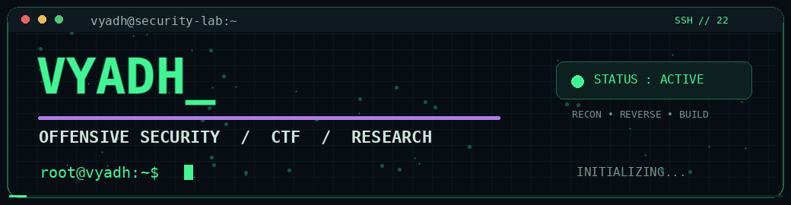

<div align="center">



[](https://git.io/typing-svg)

[](https://github.com/aayush-ethclhkr)


> **Breaking systems to understand them. Building tools to secure them.**

</div>

---

### `root@vyadh:~$ whoami`

```yaml
handle: VYADH
name: Aayush
role: Cybersecurity Researcher / Security Tool Developer
education:
  - B.Tech CSE | MIET Meerut
  - Cybersecurity minor | IIT Guwahati
certifications: [CEH, CPENT]
internship_experience: [Indian Army, DRDO]
focus: [Offensive Security, Web Security, Reverse Engineering, CTF, Automation]
building: [SafeByte V2, AI-assisted Reconnaissance, Cyber Range]
motto: "Understand the attack. Engineer the defense."
```

---

### `root@vyadh:~$ cat ~/toolkit/core.txt`

**Core stack & priority tools**

             

> **Extended toolkit:** A map of pentesting, CTF, forensics, and defensive tools I use, study, or experiment with in authorized labs. Listing a tool here does not imply expert proficiency in every one of them.

### `root@vyadh:~$ tree ~/arsenal/`

<p align="center"><i>Click a category to expand the arsenal ↓</i></p>

<details>
<summary><b>🔎 Reconnaissance & OSINT</b> <sup>(27 tools)</sup></summary>

<br>

                          

</details>

<details>
<summary><b>🌐 Web Applications & API Security</b> <sup>(24 tools)</sup></summary>

<br>

                       

</details>

<details>
<summary><b>🕸️ Network, Enumeration & Exploitation</b> <sup>(22 tools)</sup></summary>

<br>

                     

</details>

<details>
<summary><b>🪟 Active Directory & Windows Security</b> <sup>(17 tools)</sup></summary>

<br>

                

</details>

<details>
<summary><b>🔐 Passwords, Hashes & Cryptography</b> <sup>(16 tools)</sup></summary>

<br>

               

</details>

<details>
<summary><b>🧬 Reverse Engineering, Pwn & Mobile</b> <sup>(23 tools)</sup></summary>

<br>

                      

</details>

<details>
<summary><b>🧪 Digital Forensics, Stego & Malware Analysis</b> <sup>(22 tools)</sup></summary>

<br>

                     

</details>

<details>
<summary><b>☁️ Cloud, Containers & DevSecOps</b> <sup>(20 tools)</sup></summary>

<br>

                   

</details>

<details>
<summary><b>🛡️ Blue Team, DFIR & Adversary Emulation</b> <sup>(18 tools)</sup></summary>

<br>

                 

</details>

<details>
<summary><b>💻 Platforms, Languages & Infrastructure</b> <sup>(18 tools)</sup></summary>

<br>

                 

</details>

---

### `root@vyadh:~$ ls -la ~/projects`

| Project | Mission | Status |
| :--- | :--- | :--- |
| **SafeByte V2** | Modular security toolkit for assessment, monitoring, and analysis | In development |
| **AI Red Teamer** | AI-assisted reconnaissance and security analysis | In development |
| **Cyber Range** | Isolated red / blue team experimentation environment | Lab design |
| **Domain Recon** | Domain discovery and reconnaissance automation | Script tooling |
| **CTF Writeups** | Reproducible findings, scripts, and explanations | Ongoing |

> Pin repositories once they are public and documented; never commit targets, secrets, credentials, or private findings.

### `root@vyadh:~$ tail -f achievements.log`

```console
[2026] Null Origin Finale   → Individual Rank #1 | MVP
[2026] BSides Mumbai CTF    → Overall Rank #9
[EVENT] Hackathon Havoc    → 3rd Place
```

### `root@vyadh:~$ git log --stat`

<div align="center">


</div>

### `root@vyadh:~$ ./contribution-snake.sh`

> 🐍 Contribution snake: the included GitHub Actions workflow generates it. After you run the workflow successfully, uncomment the Markdown image line below.

<!-- Uncomment after the `Generate contribution snake` workflow creates the output branch:

-->

---

<div align="center">

[](https://github.com/aayush-ethclhkr?tab=repositories)

`[ ACCESS GRANTED // RESEARCH RESPONSIBLY // KEEP BUILDING ]`

</div>
